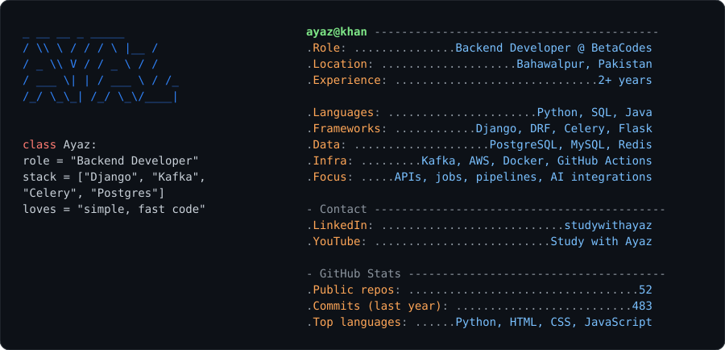

  

<b>Bahawalpur, Pakistan</b>

  

I build the parts of a product people don't see: APIs, background jobs, data pipelines, and integrations that have to keep working at 3 AM. For 2+ years I've been shipping production backends in Python, Django and DRF. That started with a travel booking platform, moved to EDI systems for 10+ large US retailers, and today it's real-time pipelines that feed AI services.

I care about code that's simple, fast, and easy for the next person to pick up.

---

### What I'm doing now

**Backend Developer @ BetaCodes** · Mar 2026 – Present
- Building backend features for **Trendwise**, a social and web media monitoring platform: team-based multi-tenancy, role-based access control, Google and email-OTP sign-in, and **Stripe**-based plan limits and billing
- Working on the crawl pipeline for 6 platforms (YouTube, X, web, Facebook, Instagram, TikTok) over **Kafka**, and integrating with AI services for search, chat, OCR and speech-to-text
- Building and maintaining 10+ scheduled **Celery Beat** jobs for plan-based recrawls, usage tracking and stale-job cleanup

### Where I've been

**Backend Developer @ Devticks** · Oct 2024 – Feb 2026
- Built Django EDI systems for **10+ retail partners** (Walmart, Home Depot, Target), handling ~5,000–10,000 orders
- Parsed **ANSI X12** files into Django models and generated acknowledgments, shipment notices and invoices automatically
- Removed N+1 queries, refactored queue processing and added indexing/caching, which **cut API calls by ~30%**
- Ran background processing on **AWS SQS** and kept partner **SFTP/AS2** connections running

**Junior Python Developer @ Ticketistan** · Jul 2024 – Oct 2024
- Built REST APIs for hotel booking, flight search and user authentication
- Worked with senior developers and the frontend team to ship features and fix issues in day-to-day development

---

### Things I've built

| Project | What it does | Stack |
|---|---|---|
| **RedArt EDI Platform** · [backend](https://github.com/ayazkhan1410/RedArt-EDI-Backend) · [frontend](https://github.com/ayazkhan1410/RedArt-EDI-Frontend) | Freelance build for a US medical transport (NEMT) billing company. Generates HIPAA X12 837P claim files, batches them and sends them over SFTP, then reads 999/277/835 files back to update claim status. Billing staff track it all in a React dashboard. | Django, DRF, PostgreSQL, Celery, Redis, Docker, React, TypeScript |
| [**LESA Academy Portal**](https://github.com/ayazkhan1410/lesa-academy-portal) | Full-stack management system for an academy: students, fees, attendance, salaries and expenses, with a dashboard, PDF reports and SMS alerts to parents. | Django, DRF, Celery, Redis, React |
| [**Agentic AI with Django**](https://github.com/ayazkhan1410/Agentic-AI-with-Django) | REST API where a supervisor agent routes questions to a document agent or a TMDB movie-search agent, with conversation memory. | DRF, LangChain, LangGraph, OpenAI |
| [**Tijori POS**](https://github.com/ayazkhan1410/retail-pos-system) | Barcode point-of-sale system for Pakistani retail: sales, shifts, returns, inventory, purchases and khata ledgers, with role-based staff permissions, reports, backups and an English/Urdu React till UI. | Django, DRF, PostgreSQL, React, TypeScript, Docker |

---

### Toolbox

  

**Core:** Python · Django · Django REST Framework · Flask · Celery · SQL\
**Data:** PostgreSQL · MySQL · Redis · Elasticsearch · Kafka\
**Cloud & DevOps:** AWS (EC2, S3, SQS) · Docker · Docker Compose · GitHub Actions\
**Also:** EDI (ANSI X12 / HIPAA) · JWT auth · SFTP/AS2 · LangChain · LangGraph · Swagger/OpenAPI

---

### Outside of work

I teach Python and Django on my YouTube channel, **[Study with Ayaz](https://www.youtube.com/@studywithayaz)**. Explaining things clearly turns out to be the best way to really understand them.

🎓 BS Information Technology, The Islamia University of Bahawalpur (2020 – 2024)

---

### Let's talk

Open to backend roles and interesting projects.

**[Portfolio](https://ayazkhan1410.github.io/ayaz-portfolio/)** · [LinkedIn](https://www.linkedin.com/in/studywithayaz/) · [YouTube](https://www.youtube.com/@studywithayaz) · [programmingwithayaz@gmail.com](mailto:programmingwithayaz@gmail.com)

